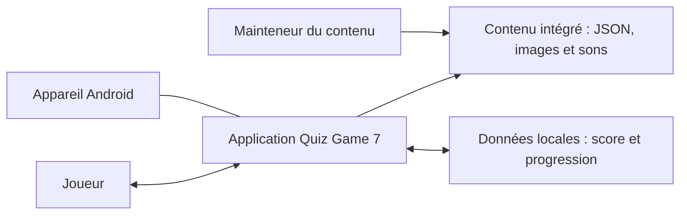
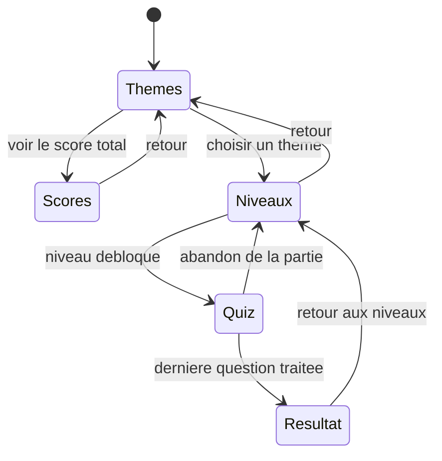
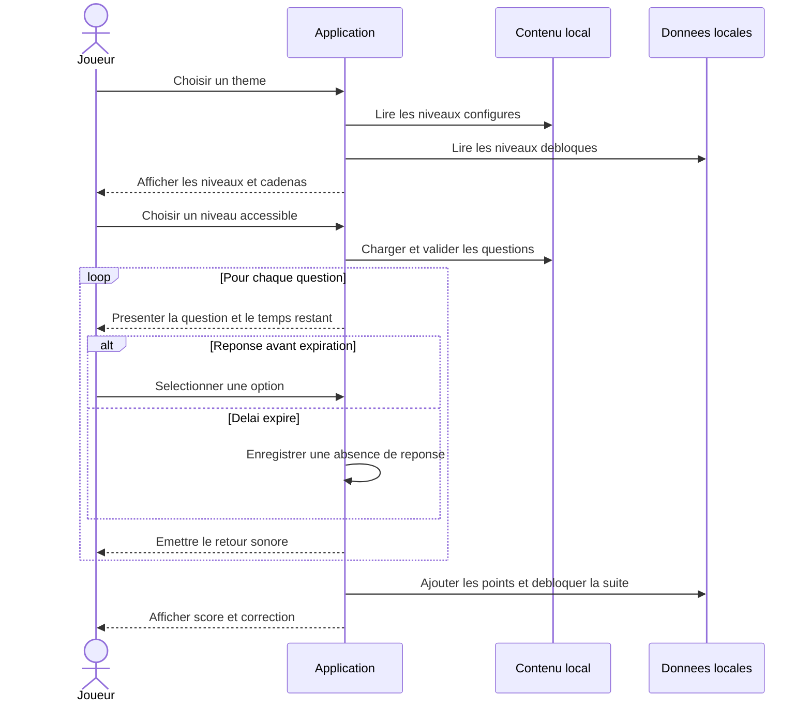

# Analyse fonctionnelle — Quiz Game 7 « Quiz éducatif »

| Élément | Description |
|---|---|
| Produit analysé | Application mobile Flutter/Android **Quiz Game 7 — Quiz éducatif** |
| Version du produit | `1.0.0+1` |
| Type d’analyse | Analyse fonctionnelle de l’existant, établie à partir du code restauré et corrigé |
| Date | 24 octobre 2026 |
| Documents liés | [`README.md`](README.md) · [`FONCTIONS.md`](FONCTIONS.md) · [`CORRECTIONS.md`](CORRECTIONS.md) |
| Périmètre principal | Utilisation normale de l’application par un joueur, en local et sans compte |
| Périmètre secondaire | Intégration du contenu pédagogique par un mainteneur avant compilation |

> **Lecture du document.** L’analyse décrit le comportement réellement
> implémenté dans le code actuel. Les fonctions proposées mais absentes sont
> regroupées séparément aux chapitres 16 et 17 afin de ne pas les confondre avec
> l’existant. Les questions présentes dans `assets/questions/` sont des
> exemples fonctionnels : 8 thèmes × 1 niveau × 3 questions, soit 24
> questions d’échantillon destinées à être remplacées par le contenu réel.

---

## Synthèse

Quiz Game 7 est une application éducative de questions à choix multiple.
Un joueur choisit un thème, sélectionne un niveau débloqué, puis répond à
une série de questions dans un temps limité de 10 secondes par question.
À la fin du niveau, l’application calcule son score, affiche la correction
détaillée, ajoute les points à un score total local et débloque le niveau
suivant configuré.

La fonction globale du produit est la suivante :

> **Permettre à un joueur d’apprendre et d’évaluer ses connaissances au
> moyen de quiz thématiques chronométrés à niveaux progressifs, tout en
> conservant localement son score total et sa progression.**

L’application fonctionne avec des contenus intégrés au package et une
sauvegarde locale. Elle ne nécessite ni création de compte, ni serveur,
ni connexion réseau pendant le jeu.

---

## 1. Contexte et objectifs

### 1.1 Contexte

Le produit s’adresse à un apprenant qui souhaite réviser ou tester ses
connaissances de manière autonome et ludique. Les questions sont classées
à la fois par thèmes et par niveaux. La progression verrouillée incite le
joueur à avancer progressivement, tandis que le minuteur, les sons et les
scores renforcent l’aspect ludique.

### 1.2 Objectifs du produit

| Code | Objectif |
|---|---|
| O1 | Faciliter l’apprentissage et l’auto-évaluation par des questions à choix multiple. |
| O2 | Organiser les connaissances par thèmes et par niveaux de progression. |
| O3 | Donner un retour immédiat par le son, puis une correction complète en fin de niveau. |
| O4 | Motiver le joueur grâce au temps limité, aux niveaux débloqués et au score cumulatif. |
| O5 | Conserver la progression entre les sessions sans exiger de compte ni de réseau. |
| O6 | Permettre l’ajout de nouvelles questions et de niveaux par de simples fichiers de contenu. |
| O7 | Présenter des messages compréhensibles lorsque le contenu ou la sauvegarde pose problème. |

### 1.3 Ce que le produit ne cherche pas à faire

Le produit ne constitue ni une plateforme d’apprentissage en ligne, ni un
système de gestion de classe. Il ne gère pas de comptes multiples, de
classement entre joueurs, de synchronisation distante ou d’administration
du contenu depuis l’interface.

---

## 2. Expression du besoin

### 2.1 Bête à cornes

| Question | Réponse |
|---|---|
| **À qui le produit rend-il service ?** | À un joueur ou apprenant individuel qui souhaite réviser et évaluer ses connaissances. |
| **Sur quoi agit-il ?** | Sur un ensemble structuré de questions à choix multiple classées par thèmes et niveaux, ainsi que sur la progression et le score du joueur. |
| **Dans quel but ?** | Apprendre de façon ludique et autonome, mesurer ses résultats et progresser niveau après niveau. |

### 2.2 Formulation du besoin

> Le produit doit permettre au joueur de s’entraîner et d’évaluer ses
> connaissances à l’aide de quiz thématiques chronométrés à niveaux
> progressifs, tout en suivant localement son score et les niveaux
> débloqués.

### 2.3 Validation du besoin

| Critère | Analyse |
|---|---|
| Le besoin est-il réel ? | Oui : il répond à un usage d’apprentissage et de révision autonome sur mobile. |
| Le besoin est-il stable ? | Oui dans son principe. Les contenus, thèmes et niveaux peuvent évoluer sans changer la fonction principale. |
| Qu’est-ce qui pourrait le faire évoluer ? | Le besoin de plusieurs profils, d’un seuil de réussite, d’un historique, d’explications pédagogiques ou d’une synchronisation en ligne. |
| Qu’est-ce qui pourrait le faire disparaître ? | Le remplacement par une plateforme éducative complète de type LMS ou par un service multijoueur en ligne. Ces évolutions restent hors du périmètre actuel. |

---

## 3. Périmètre fonctionnel

### 3.1 Inclus dans l’existant

- Affichage et sélection de **8 thèmes prédéfinis**.
- Lecture des niveaux disponibles pour chaque thème depuis un fichier local.
- Verrouillage et déblocage progressif des niveaux.
- Chargement et validation des questions locales.
- Mélange de l’ordre des options à chaque chargement.
- Réponse aux questions une par une avec un minuteur.
- Prise en compte automatique d’une absence de réponse à la fin du délai.
- Retour sonore « bonne réponse » ou « mauvaise réponse ».
- Calcul du score d’un niveau.
- Affichage du résultat et de la correction question par question.
- Ajout des points obtenus à un score total persistant.
- Consultation et réinitialisation du score total.
- Réinitialisation de la progression thème par thème.
- Gestion des états de chargement, d’absence de contenu et d’erreur.
- Rotation d’images de fond.

### 3.2 Hors périmètre actuel

- Création de compte, authentification et gestion de plusieurs joueurs.
- Serveur, base de données distante, synchronisation et classement en ligne.
- Mode multijoueur ou défi entre utilisateurs.
- Éditeur de questions intégré à l’application.
- Historique détaillé des parties et statistiques par thème ou niveau.
- Certification, examen surveillé ou anti-triche avancée.
- Achat, publicité ou monétisation.
- Réglages utilisateur de durée, difficulté, langue ou volume.
- Explications pédagogiques associées à chaque question.

### 3.3 Hypothèses

| Code | Hypothèse |
|---|---|
| H1 | Un seul joueur utilise la progression sauvegardée sur un appareil donné. |
| H2 | Le contenu pédagogique est validé à l’extérieur : l’application contrôle sa forme, pas la véracité des réponses. |
| H3 | Le joueur comprend l’interface en français ; les questions peuvent contenir du texte en arabe ou dans une autre langue. |
| H4 | Les contenus et médias sont intégrés au moment de la compilation. |
| H5 | La cible d’utilisation livrée dans le dépôt est Android. |
| H6 | Aucune connexion réseau n’est nécessaire pour jouer après installation. |

---

## 4. Acteurs et environnement

### 4.1 Acteurs

| Acteur | Type | Rôle fonctionnel |
|---|---|---|
| **Joueur / apprenant** | Principal | Choisit un thème et un niveau, répond aux questions, consulte ses résultats et son score, réinitialise éventuellement ses données. |
| **Mainteneur du contenu** | Secondaire, hors exécution | Prépare ou remplace les fichiers de questions, d’images et de sons avant la compilation de l’application. |
| **Appareil Android** | Environnement technique | Fournit l’écran tactile, le haut-parleur, le cycle de vie de l’application et le stockage local. |
| **Contenu intégré** | Ressource externe au moteur de jeu | Fournit les niveaux et questions au format JSON, ainsi que les images et sons. |
| **Stockage local** | Ressource système | Conserve le score total et les niveaux débloqués entre les sessions. |

Le minuteur n’est pas un acteur externe : il s’agit d’un événement interne
du système déclenché après le délai accordé pour la question courante.

### 4.2 Diagramme de contexte



---

## 5. Analyse APTE

### 5.1 Éléments du milieu extérieur

| Code | Élément du milieu extérieur |
|---|---|
| E1 | Joueur / apprenant |
| E2 | Contenu pédagogique intégré |
| E3 | Appareil Android et ses périphériques |
| E4 | Stockage local de l’appareil |
| E5 | Mainteneur du contenu |
| E6 | Environnement d’usage : interruptions, tailles d’écran, absence de réseau |

### 5.2 Fonctions principales

| Code | Éléments reliés | Fonction principale |
|---|---|---|
| FP1 | Joueur ↔ Contenu pédagogique | Permettre au joueur de répondre à des questions à choix multiple classées par thèmes et niveaux et de recevoir leur correction. |
| FP2 | Joueur ↔ Stockage local | Permettre au joueur de retrouver entre les sessions ses niveaux débloqués et son score total. |
| FP3 | Mainteneur ↔ Contenu pédagogique | Permettre au mainteneur de structurer et d’intégrer les questions par thème et par niveau dans les fichiers livrés avec l’application. |

### 5.3 Fonctions contraintes

| Code | Élément concerné | Fonction contrainte |
|---|---|---|
| FC1 | Appareil Android | S’adapter à l’écran tactile, à sa largeur, au haut-parleur et aux passages de l’application en arrière-plan. |
| FC2 | Contenu pédagogique | N’accepter que des contenus structurés et valides ; signaler clairement un contenu absent ou mal formé. |
| FC3 | Stockage local | Conserver une progression et un score cohérents, sans bloquer l’affichage du résultat si la sauvegarde échoue. |
| FC4 | Joueur | Être compréhensible et rassurant : montrer le temps restant, l’avancement, le score et demander confirmation avant un effacement. |
| FC5 | Environnement d’usage | Fonctionner en local, sans compte et sans connexion pendant le jeu. |
| FC6 | Mainteneur | Utiliser une organisation prévisible des fichiers et des identifiants de thèmes stables. |

### 5.4 Cahier des charges fonctionnel simplifié

L’échelle de flexibilité utilisée est : **F0 = impératif**, **F1 = faible**,
**F2 = moyenne**, **F3 = forte**.

| Fonction | Critère | Niveau constaté dans le produit | Flexibilité |
|---|---|---|---:|
| FP1 | Nombre de thèmes proposés | 8 thèmes codés dans l’application | F1 |
| FP1 | Organisation des questions | Par thème, puis par niveau | F1 |
| FP1 | Temps accordé par question | 10 secondes par défaut | F2 |
| FP1 | Type de réponse | Un choix parmi au moins 2 options | F0 |
| FP1 | Correction | Réponse du joueur et bonne réponse en fin de niveau | F1 |
| FP1 | Retour pendant le jeu | Son distinct pour réponse correcte et incorrecte/expirée | F2 |
| FP2 | Niveau initial | Niveau 1 seul débloqué au démarrage d’un thème | F0 |
| FP2 | Progression | Niveau suivant débloqué à la fin du niveau courant, indépendamment du score | F2 |
| FP2 | Score d’un niveau | 1 point par bonne réponse | F1 |
| FP2 | Score total | Somme cumulative des points de toutes les parties terminées | F2 |
| FP2 | Persistance | Score et progression conservés localement entre les sessions | F0 |
| FP3 | Ajout d’un niveau à un thème existant | Mettre à jour `levels.json` et ajouter `level_N.json`, puis recompiler | F1 |
| FC1 | Adaptation d’écran | 2 colonnes de thèmes sous 700 px, 4 colonnes au-delà | F2 |
| FC2 | Contenu invalide | Message explicite et nouvel essai lorsque c’est pertinent | F1 |
| FC4 | Effacements | Confirmation obligatoire avant réinitialisation | F0 |
| FC5 | Fonctionnement réseau | Aucune fonction de jeu ne requiert le réseau | F0 |

> Les niveaux ci-dessus décrivent le produit actuel. Ce sont des constats,
> pas nécessairement les choix définitifs d’un futur cahier des charges.

---

## 6. Décomposition fonctionnelle

```text
F0  Permettre l’apprentissage par quiz thématiques progressifs
├── F1  Accueillir et orienter le joueur
│   ├── F1.1  Présenter les thèmes disponibles
│   ├── F1.2  Décrire brièvement chaque thème
│   └── F1.3  Donner accès au score total
├── F2  Organiser l’accès aux niveaux
│   ├── F2.1  Déterminer les niveaux configurés d’un thème
│   ├── F2.2  Distinguer les niveaux accessibles et verrouillés
│   ├── F2.3  Bloquer un niveau non encore accessible
│   └── F2.4  Présenter l’état d’avancement des déblocages
├── F3  Dérouler une partie
│   ├── F3.1  Charger et valider les questions d’un niveau
│   ├── F3.2  Présenter les questions successivement
│   ├── F3.3  Mélanger les options de chaque question
│   ├── F3.4  Limiter le temps de réflexion
│   ├── F3.5  Suspendre le temps lorsque l’application est interrompue
│   ├── F3.6  Recueillir la réponse ou constater son absence
│   └── F3.7  Fournir un retour sonore immédiat
├── F4  Évaluer et restituer le résultat
│   ├── F4.1  Calculer le nombre de bonnes réponses
│   ├── F4.2  Présenter le résultat du niveau
│   ├── F4.3  Corriger chaque question
│   └── F4.4  Signaler le déblocage du niveau suivant
├── F5  Capitaliser la progression
│   ├── F5.1  Ajouter les points gagnés au score total
│   ├── F5.2  Débloquer le niveau suivant
│   ├── F5.3  Conserver les données entre les sessions
│   ├── F5.4  Consulter le score total
│   └── F5.5  Réinitialiser le score ou la progression après confirmation
├── F6  Assurer la continuité du service
│   ├── F6.1  Indiquer les chargements
│   ├── F6.2  Indiquer l’absence de contenu ou une erreur
│   ├── F6.3  Permettre de réessayer après un échec de chargement
│   └── F6.4  Continuer sans retour sonore si un son ne peut pas être lu
└── F7  Maintenir le contenu
    ├── F7.1  Structurer les contenus par thème et niveau
    ├── F7.2  Contrôler la validité des fichiers de contenu
    └── F7.3  Intégrer les contenus et médias à l’application
```

---

## 7. Cas d’utilisation

### 7.1 Vue d’ensemble

| Code | Cas d’utilisation | Acteur | But |
|---|---|---|---|
| CU-01 | Choisir un thème | Joueur | Accéder aux niveaux correspondant au sujet choisi. |
| CU-02 | Consulter les niveaux d’un thème | Joueur | Voir les niveaux existants et ceux déjà accessibles. |
| CU-03 | Jouer un niveau | Joueur | Répondre à toutes les questions du niveau dans le temps prévu. |
| CU-04 | Consulter le résultat d’un niveau | Joueur | Connaître son score et examiner la correction. |
| CU-05 | Consulter le score total | Joueur | Connaître le nombre cumulé de points gagnés. |
| CU-06 | Réinitialiser le score total | Joueur | Remettre le compteur général à zéro. |
| CU-07 | Réinitialiser la progression d’un thème | Joueur | Revenir au seul niveau 1 pour ce thème. |
| CU-08 | Réessayer après une erreur de chargement | Joueur | Relancer le chargement sans quitter l’écran. |
| CU-09 | Mettre à jour les questions | Mainteneur | Ajouter ou modifier des contenus avant une nouvelle compilation. |

### 7.2 CU-03 — Jouer un niveau

| Élément | Description |
|---|---|
| Acteur principal | Joueur |
| Précondition | L’application est ouverte ; le niveau choisi est configuré et débloqué. |
| Déclencheur | Le joueur touche un niveau disponible. |
| Postcondition en cas de succès | Le résultat est affiché ; le score total est augmenté des points du niveau ; le niveau suivant éventuel devient accessible. |
| Postcondition en cas d’abandon | Aucun point n’est ajouté et aucun niveau n’est débloqué pour la partie abandonnée. |

#### Scénario nominal

1. Le joueur choisit un thème.
2. Le système présente les niveaux configurés et leur état de verrouillage.
3. Le joueur choisit un niveau débloqué.
4. Le système charge et contrôle les questions du niveau.
5. Le système présente la première question, ses options mélangées,
   l’avancement global, le score courant et le temps restant.
6. Le minuteur décrémente le temps restant chaque seconde.
7. Le joueur sélectionne une option avant expiration du délai.
8. Le système émet le retour sonore correspondant, enregistre la réponse
   et affiche la question suivante, ou termine le niveau s’il s’agissait
   de la dernière question.
9. Les étapes 5 à 8 se répètent jusqu’à la dernière question.
10. Le système calcule le score du niveau.
11. Le système ajoute ce score au score total sauvegardé.
12. Le système débloque, lorsqu’il existe, le niveau suivant configuré.
13. Le système présente le score et la correction détaillée.
14. Le joueur revient à la liste des niveaux, dont les états sont actualisés.

#### Extensions et situations particulières

| Référence | Situation | Comportement attendu et constaté |
|---|---|---|
| E1 | Le joueur touche un niveau verrouillé. | La commande est inactive ; le message indique qu’il faut terminer le niveau précédent. |
| E2 | Le délai d’une question expire. | La réponse est enregistrée comme absente, le son d’échec est joué et la partie passe à la suite. |
| E3 | L’application passe en arrière-plan pendant le minuteur. | Le minuteur est suspendu, puis reprend avec le temps restant au retour au premier plan. |
| E4 | Le joueur revient en arrière pendant une partie. | La partie est abandonnée ; ses réponses ne sont pas historisées, aucun point n’est ajouté et aucun nouveau niveau n’est débloqué. |
| E5 | Aucun niveau n’est configuré. | Un message « Aucun niveau n’est encore configuré pour ce thème » est affiché. |
| E6 | Un fichier de niveaux ou de questions est absent ou invalide. | Un message explicite désigne le problème ; l’écran propose « Réessayer » lorsqu’un rechargement est prévu. |
| E7 | Le fichier de questions contient une question invalide. | Le niveau n’est pas joué ; l’erreur désigne la question concernée. |
| E8 | Un son de retour ne peut pas être lu. | La partie continue sans interruption ; l’échec est seulement journalisé en débogage. |
| E9 | La sauvegarde du score ou du déblocage échoue. | Le résultat reste affiché et un avertissement de persistance est présenté au joueur. |
| E10 | Le joueur refait un niveau déjà terminé. | Une nouvelle partie est possible ; ses points s’ajoutent de nouveau au total et le niveau suivant déjà débloqué peut être annoncé à nouveau. |

### 7.3 Autres cas d’utilisation détaillés

#### CU-05 — Consulter le score total

1. Le joueur active l’icône « trophée » depuis l’accueil.
2. Le système affiche un indicateur de chargement.
3. Le système lit le total sauvegardé et l’affiche en points.
4. Si le total est supérieur à zéro, le système propose sa réinitialisation.
5. En cas d’échec de lecture, un message d’erreur est affiché.

#### CU-06 — Réinitialiser le score total

1. Précondition : le score total est supérieur à zéro.
2. Le joueur demande la réinitialisation.
3. Le système demande confirmation.
4. Si le joueur annule, le score reste inchangé.
5. Si le joueur confirme, le système enregistre zéro puis recharge l’écran.

#### CU-07 — Réinitialiser la progression d’un thème

1. Précondition : le thème courant comporte au moins un niveau et le
   chargement est terminé.
2. Le joueur demande la réinitialisation.
3. Le système précise que les niveaux débloqués de ce thème seront remis
   à zéro et demande confirmation.
4. Après confirmation, seule la progression de ce thème est effacée,
   puis le niveau 1 redevient l’unique niveau accessible.
5. La liste est rechargée ; les scores et autres thèmes ne sont pas
   modifiés par cette action.

#### CU-09 — Mettre à jour les questions

1. Le mainteneur choisit le dossier du thème concerné.
2. Pour modifier un niveau existant, il remplace le fichier
   `level_N.json`.
3. Pour ajouter un niveau, il ajoute son numéro dans `levels.json` et
   crée le fichier `level_N.json` correspondant.
4. Il recompile et distribue une nouvelle version de l’application.
5. Au lancement, l’application contrôle la forme des nouveaux fichiers ;
   en cas d’erreur, elle affiche le chemin et la cause identifiable.

---

## 8. Parcours et enchaînements

### 8.1 Navigation entre écrans



### 8.2 Séquence fonctionnelle d’une partie réussie



### 8.3 États d’un niveau

| État fonctionnel | Signification | Passage à l’état suivant |
|---|---|---|
| Configuré et verrouillé | Le niveau existe mais n’est pas encore accessible. | Le niveau précédent configuré est terminé. |
| Accessible | Le niveau peut être lancé ; le niveau 1 l’est initialement. | Le joueur le sélectionne. |
| En cours | Une partie est active sur ce niveau. | Fin des questions ou abandon. |
| Terminé pour la partie | Les réponses et le résultat sont produits. | Affichage du résultat ; niveau rejouable. |
| Réinitialisé | La progression du thème a été effacée. | Le niveau 1 redevient le seul accessible. |

Le produit ne conserve pas un état durable « niveau déjà réussi » distinct
de l’ensemble des niveaux débloqués. Rejouer un niveau accessible reste
toujours possible.

---

## 9. Exigences fonctionnelles détaillées

Priorités : **I** = indispensable, **P** = importante,
**C** = complémentaire. Le statut décrit l’existant analysé.

### 9.1 Accueil et choix du parcours

| Code | Exigence fonctionnelle | Critère d’acceptation principal | Pri. | Statut |
|---|---|---|:---:|---|
| EF-01 | Le système présente les thèmes disponibles sous forme de cartes comprenant icône, libellé et courte description. | Les 8 thèmes prédéfinis sont visibles dans une grille de 2 ou 4 colonnes selon la largeur. | I | Réalisée |
| EF-02 | Le joueur peut accéder au score total depuis l’accueil. | L’action « trophée » ouvre l’écran « Tous les scores ». | P | Réalisée |
| EF-03 | Le choix d’un thème conduit aux niveaux de ce thème uniquement. | Le titre et les niveaux chargés correspondent au thème sélectionné. | I | Réalisée |

### 9.2 Niveaux et progression

| Code | Exigence fonctionnelle | Critère d’acceptation principal | Pri. | Statut |
|---|---|---|:---:|---|
| EF-04 | Le système détermine les niveaux disponibles à partir de la configuration du thème. | Les numéros valides sont triés et affichés sans doublon. | I | Réalisée |
| EF-05 | À la première utilisation d’un thème, seul le niveau 1 est accessible. | Les autres niveaux configurés affichent un cadenas et ne lancent pas de partie. | I | Réalisée |
| EF-06 | Le système indique le nombre de niveaux débloqués sur le nombre total. | L’en-tête affiche « x / y niveaux débloqués ». | C | Réalisée |
| EF-07 | Un niveau accessible peut être lancé et rejoué. | La sélection d’un niveau accessible ouvre une nouvelle partie. | I | Réalisée |
| EF-08 | La progression est conservée par thème entre les sessions. | Après fermeture et réouverture, les cadenas reflètent les niveaux déjà débloqués. | I | Réalisée |
| EF-09 | Le joueur peut réinitialiser la progression d’un thème après confirmation. | Après confirmation, le niveau 1 est seul accessible ; une annulation ne modifie rien. | P | Réalisée |

### 9.3 Chargement et déroulement des questions

| Code | Exigence fonctionnelle | Critère d’acceptation principal | Pri. | Statut |
|---|---|---|:---:|---|
| EF-10 | Le système charge les questions du niveau sélectionné depuis le contenu local. | Les questions du fichier correspondant sont utilisées pour la partie. | I | Réalisée |
| EF-11 | Le système contrôle la validité structurelle des questions avant la partie. | Un JSON absent, invalide ou incomplet produit un message d’erreur et non un plantage. | I | Réalisée |
| EF-12 | Les options de chaque question sont présentées dans un ordre mélangé. | La bonne réponse n’est pas systématiquement la première option. | P | Réalisée |
| EF-13 | Les questions sont posées une par une dans l’ordre du fichier. | Une seule question et ses options sont visibles à la fois. | I | Réalisée |
| EF-14 | Le joueur voit sa position dans le niveau et le score courant. | « Question i sur n », barre de progression du niveau et score sont affichés. | P | Réalisée |
| EF-15 | Chaque question dispose par défaut de 10 secondes. | Le compte à rebours et sa jauge diminuent chaque seconde ; les 3 dernières secondes sont signalées en rouge. | I | Réalisée |
| EF-16 | À expiration du délai, la question est traitée comme sans réponse. | La partie avance automatiquement et la correction affichera « Aucune réponse ». | I | Réalisée |
| EF-17 | La sélection d’une option termine immédiatement la question courante. | Aucun bouton de validation séparé n’est nécessaire ; la question suivante reçoit un nouveau délai complet. | I | Réalisée |
| EF-18 | Le minuteur se suspend lorsque l’application n’est plus au premier plan. | Au retour, la même question reprend avec le temps restant avant interruption. | P | Réalisée |
| EF-19 | Le système émet un retour sonore après chaque question traitée. | Un son « correct » est joué pour une bonne réponse et un son « wrong » sinon ; une erreur audio n’interrompt pas la partie. | C | Réalisée |

### 9.4 Résultats et score total

| Code | Exigence fonctionnelle | Critère d’acceptation principal | Pri. | Statut |
|---|---|---|:---:|---|
| EF-20 | Le score du niveau est le nombre de réponses exactement égales à la bonne réponse. | Une bonne réponse vaut 1 point ; une mauvaise ou absente vaut 0. | I | Réalisée |
| EF-21 | Le système affiche le résultat du niveau et sa correction détaillée. | Le score « x / n », le thème, le niveau, la réponse donnée et la bonne réponse en cas d’erreur sont visibles. | I | Réalisée |
| EF-22 | Un score parfait est distingué visuellement. | Une icône de célébration remplace l’icône habituelle si toutes les réponses sont correctes. | C | Réalisée |
| EF-23 | Les points d’un niveau terminés sont ajoutés au score total. | Le nouvel affichage du total tient compte des points de la partie. | I | Réalisée |
| EF-24 | Le niveau suivant configuré est débloqué à la fin du niveau, indépendamment du score. | Après une partie à 0 point sur un niveau accessible, le niveau suivant devient lui aussi accessible. | P | Réalisée* |
| EF-25 | Le retour à la liste depuis le résultat actualise les déblocages. | Le nouveau niveau accessible n’affiche plus de cadenas. | P | Réalisée |
| EF-26 | Le joueur peut consulter le score total cumulatif. | L’écran des scores affiche un entier positif ou nul en points. | P | Réalisée |
| EF-27 | Le joueur peut effacer le score total après confirmation. | Le bouton n’apparaît que si le total est supérieur à zéro ; après confirmation, le total vaut zéro. | P | Réalisée |

\* EF-24 est une règle de l’existant. Elle est signalée au chapitre 16,
car elle peut être jugée trop permissive sur le plan pédagogique.

### 9.5 Robustesse fonctionnelle et présentation

| Code | Exigence fonctionnelle | Critère d’acceptation principal | Pri. | Statut |
|---|---|---|:---:|---|
| EF-28 | Pendant un chargement local, le système présente un retour d’attente. | Un indicateur de progression est visible jusqu’à l’affichage ou l’erreur. | P | Réalisée |
| EF-29 | En cas d’erreur de contenu, le joueur peut relancer le chargement prévu à l’écran. | Les écrans de niveaux et de quiz proposent « Réessayer ». | P | Réalisée |
| EF-30 | En cas d’erreur de sauvegarde en fin de partie, le résultat reste consultable. | L’avertissement est affiché sans empêcher la correction. | P | Réalisée |
| EF-31 | Si aucun niveau ou aucune question n’est disponible, le système présente un état vide explicite. | Aucun écran blanc ou arrêt brutal n’est produit. | I | Réalisée |
| EF-32 | L’arrière-plan alterne des images locales sans masquer le contenu. | Trois images se succèdent avec un fondu ; une image illisible est remplacée par une couleur de secours. | C | Réalisée |
| EF-33 | Le système fonctionne sans saisie de compte et sans accès réseau pendant le jeu. | Toutes les fonctions de jeu et de consultation restent disponibles en mode avion après installation. | I | Réalisée |
| EF-34 | Le mainteneur peut ajouter un niveau à un thème existant par les fichiers de contenu. | Après recompilation, le nouveau niveau apparaît et suit la règle de progression. | P | Réalisée |

---

## 10. Règles de gestion

| Code | Règle |
|---|---|
| RG-01 | Les thèmes sont prédéfinis dans le produit. Un nouvel intitulé de thème ne peut pas être créé depuis l’interface. |
| RG-02 | L’identifiant d’un thème est stable, normalisé en minuscules et limité aux lettres minuscules, chiffres, `_` et `-`. Il sert à retrouver le contenu et la progression. |
| RG-03 | Un thème peut déclarer zéro ou plusieurs niveaux. S’il en déclare, ils doivent être des entiers ≥ 1, sans doublon, et commencer par le niveau 1. |
| RG-04 | Les niveaux non consécutifs sont structurellement acceptés ; le « suivant » est alors le prochain numéro configuré dans l’ordre trié. |
| RG-05 | Une question doit contenir un énoncé non vide, une bonne réponse non vide et au moins deux options non vides. |
| RG-06 | Les espaces en début et fin d’énoncé, de bonne réponse et d’options sont ignorés lors de la validation. |
| RG-07 | Deux options identiques après suppression des espaces sont interdites. |
| RG-08 | La bonne réponse doit être exactement l’une des options, après nettoyage des espaces. |
| RG-09 | L’application valide la forme du contenu, mais ne juge pas si la réponse désignée comme correcte est pédagogiquement vraie. |
| RG-10 | Les questions sont jouées dans l’ordre du fichier ; seules leurs options sont mélangées à chaque chargement. |
| RG-11 | Le délai par défaut est identique pour toutes les questions d’une partie : 10 secondes. Il n’est pas modifiable par le joueur. |
| RG-12 | Une réponse doit être choisie avant expiration du délai. Une seule sélection est prise en compte par question, car la partie avance immédiatement. |
| RG-13 | Une bonne réponse vaut 1 point ; une mauvaise réponse ou une expiration vaut 0 point. Aucun point négatif ou bonus de rapidité n’est appliqué. |
| RG-14 | Le score total est cumulatif : rejouer un niveau et le terminer ajoute à nouveau les points obtenus. |
| RG-15 | Le déblocage dépend de l’achèvement du niveau, pas d’un seuil de réussite. Même un score de 0 débloque le niveau suivant configuré. |
| RG-16 | Un niveau déjà accessible peut être rejoué sans limite. Si un niveau suivant existe, le système renvoie ce niveau suivant et l’écran peut annoncer à nouveau son déblocage. |
| RG-17 | Un abandon avant la fin ne produit ni résultat, ni ajout de score, ni nouveau déblocage. |
| RG-18 | La progression est indépendante d’un thème à l’autre ; le score total est commun à tous les thèmes. |
| RG-19 | La réinitialisation des niveaux d’un thème n’efface pas le score total. La réinitialisation du score n’efface pas les niveaux débloqués. |
| RG-20 | La progression sauvée antérieurement sous une forme capitalisée d’identifiant est migrée vers la forme normalisée lorsque c’est possible. |
| RG-21 | Si la progression sauvegardée est absente ou ne contient aucun niveau positif exploitable, le niveau 1 est considéré comme accessible. |
| RG-22 | Aucune réponse individuelle d’une ancienne partie n’est conservée. Seuls le score total et les niveaux débloqués persistent. |
| RG-23 | Une erreur de lecture d’un son ne modifie ni la réponse, ni le score, ni l’enchaînement du quiz. |
| RG-24 | En cas d’échec de sauvegarde du score ou de la progression en fin de partie, le résultat de la partie est néanmoins affiché avec un avertissement. |

---

## 11. Données fonctionnelles

### 11.1 Concepts métier

| Concept | Définition fonctionnelle | Données principales | Persistance |
|---|---|---|---|
| Thème | Domaine de connaissances proposé au joueur. | Identifiant, libellé, description, icône. | Définition intégrée au produit. |
| Niveau | Étape ordonnée au sein d’un thème. | Thème, numéro, accessibilité calculée. | Numéros configurés dans le contenu ; déblocages persistés. |
| Question | Demande à choix multiple. | Énoncé, bonne réponse, liste d’options. | Fichier de contenu local. |
| Réponse donnée | Choix du joueur pour une question d’une partie. | Option choisie ou absence de réponse. | Mémoire de la partie uniquement. |
| Partie | Enchaînement des questions d’un niveau lancé. | Thème, niveau, questions, réponses, temps restant, état. | Non historisée. |
| Résultat | Synthèse d’une partie terminée. | Points obtenus, nombre de questions, correction, niveau débloqué éventuel. | Affiché ; seuls ses effets sur total et progression persistent. |
| Progression | Ensemble des niveaux accessibles par thème. | Thème, numéros débloqués. | Stockage local. |
| Score total | Cumul des points des parties terminées. | Entier ≥ 0. | Stockage local. |
| Profil utilisateur | Modèle présent dans le code mais sans usage visible dans l’application. | Nom, avatar, score. | Aucune dans l’application actuelle. |

### 11.2 Relations entre concepts

```text
Thème 1 ─── * Niveau
Niveau 1 ─── * Question
Question 1 ─── * Option
Partie 1 ─── * Réponse donnée
Partie 1 ─── 1 Résultat affiché
Thème 1 ─── 1 Progression sauvegardée
Joueur implicite 1 ─── 1 Score total
```

Il n’existe pas d’entité « joueur » gérée fonctionnellement par
l’interface : le joueur est implicite et unique pour l’installation.

### 11.3 Formats de contenu attendus

#### Liste des niveaux : `assets/questions/<theme>/levels.json`

```json
{
  "Levels": [1, 2, 3]
}
```

Variantes acceptées : clé `levels` en minuscules et valeurs entières ou
chaînes numériques. Le tableau peut être vide pour signaler qu’aucun
niveau n’est configuré.

#### Questions d’un niveau : `assets/questions/<theme>/level_N.json`

```json
[
  {
    "question": "Quelle est la capitale de la France ?",
    "correct": "Paris",
    "options": ["Paris", "Lyon", "Nice"]
  }
]
```

| Champ | Signification | Contraintes |
|---|---|---|
| `question` | Énoncé. L’ancien champ `arabe` est accepté en repli. | Chaîne non vide. |
| `correct` | Bonne réponse. L’ancien champ `correctAnswer` est accepté en repli. | Chaîne non vide, présente dans `options`. |
| `options` | Réponses proposées. | Liste de chaînes, au moins 2 éléments, sans vide ni doublon. |

#### Médias intégrés

| Média | Usage |
|---|---|
| `assets/backgrounds/bg1.png`, `bg2.png`, `bg3.jpeg` | Rotation du fond des écrans. |
| `assets/sounds/correct.mp3` | Bonne réponse. |
| `assets/sounds/wrong.mp3` | Mauvaise réponse ou délai expiré. |
| `assets/logo.png` | Ressource graphique du projet. |

### 11.4 Données persistées

| Donnée | Contenu fonctionnel | Identifiant technique constaté |
|---|---|---|
| Score total | Entier cumulatif, 0 par défaut. | `total_score` |
| Niveaux débloqués | Liste triée de numéros de niveaux par thème. | `levels__<theme>` |

Les réponses et résultats d’une partie précise ne sont pas enregistrés :
l’application ne fournit donc pas d’historique rejouable ou consultable
après avoir quitté l’écran de résultat.

### 11.5 Volumétrie de l’existant restauré

| Élément | Volume actuellement livré |
|---|---:|
| Thèmes prédéfinis | 8 |
| Niveaux d’exemple livrés | 1 par thème |
| Questions d’exemple | 3 par niveau, 24 au total |
| Comptes utilisateur | 0 compte géré ; 1 progression implicite par installation |
| Historique de parties | 0 partie conservée |

Le code ne fixe pas de nombre maximal de niveaux ou de questions autre
que les limites pratiques de taille du package et de mémoire de
l’appareil.

---

## 12. Interfaces fonctionnelles

| Écran | Entrées affichées | Actions du joueur | Sorties / états |
|---|---|---|---|
| ECR-01 — Choix du thème | Cartes des 8 thèmes, description, icône. | Choisir un thème ; ouvrir le score total. | Navigation vers les niveaux ou les scores. |
| ECR-02 — Niveaux du thème | Nom du thème, nombre débloqué, liste des niveaux, cadenas, états de chargement/erreur/vide. | Jouer un niveau accessible ; réessayer ; réinitialiser après confirmation ; revenir. | Lancement d’une partie ou liste actualisée. |
| ECR-03 — Quiz | Niveau, numéro de question, score courant, jauges de niveau et de temps, énoncé, options. | Choisir une option ; abandonner avec retour ; réessayer en cas d’échec de chargement. | Réponse enregistrée, question suivante, son, résultat en fin de partie. |
| ECR-04 — Résultat | Score du niveau, thème et niveau, message de déblocage, avertissement éventuel, correction détaillée. | Retourner aux niveaux. | Liste des niveaux actualisée. |
| ECR-05 — Score total | Total en points, chargement ou erreur, action de réinitialisation si total > 0. | Réinitialiser après confirmation ; revenir. | Total remis à zéro ou inchangé. |

### Principes d’interaction constatés

- L’interface est tactile et orientée cartes/boutons.
- Les principales actions dangereuses ou irréversibles demandent
  confirmation.
- Les éléments verrouillés sont explicitement signalés par un cadenas et
  une phrase d’explication.
- Pendant le quiz, le temps est donné en texte, par une barre et par un
  changement de couleur à partir de 3 secondes ; la jauge du temps possède
  un libellé sémantique.
- Le joueur reçoit une correction complète, mais pas d’explication
  pédagogique détaillée au-delà de la bonne réponse.
- La sélection d’une réponse ne permet ni retour à la question
  précédente ni modification.

---

## 13. Exigences non fonctionnelles et contraintes

| Code | Domaine | Exigence / constat | Appréciation |
|---|---|---|---|
| ENF-01 | Disponibilité hors ligne | Les questions, images, sons et sauvegardes sont locaux ; le jeu ne dépend d’aucun service distant. | Réalisée |
| ENF-02 | Performance | Les calculs sont simples et les données intégrées sont locales. Aucun objectif chiffré de temps de chargement n’est défini ni mesuré dans le dépôt. | À mesurer sur appareil cible |
| ENF-03 | Fiabilité | Les principaux échecs de contenu et de persistance sont interceptés et présentés sans arrêt brutal ; un son illisible n’arrête pas la partie. | Réalisée partiellement |
| ENF-04 | Utilisabilité | Parcours court, vocabulaire en français, états de chargement/erreur/vide, confirmations d’effacement, correction visible. | Réalisée |
| ENF-05 | Accessibilité | Base Material, fond assombri derrière le texte blanc, boutons élevés avec hauteur minimale définie au thème et libellé sémantique pour le temps restant. Aucun audit d’accessibilité complet n’est toutefois fourni. | Partielle, à auditer |
| ENF-06 | Maintenabilité du contenu | Dans un thème existant, un niveau se maintient par fichiers, sans déclarer chaque fichier un à un. Un nouveau thème exige une modification de configuration du produit. | Réalisée |
| ENF-07 | Extensibilité | Le nombre de niveaux/questions est piloté par fichiers ; thèmes, durée et règles de déblocage restent codés. | Partielle |
| ENF-08 | Portabilité | Le code applicatif est en Flutter, mais le dépôt livré contient et documente la cible Android ; les autres plateformes ne constituent pas un périmètre validé. | Limitée à Android |
| ENF-09 | Compatibilité | Projet destiné à Flutter ≥ 3.27 / Dart ≥ 3.0 ; Android `minSdk` 23. | Contrainte technique |
| ENF-10 | Confidentialité | L’application effective ne demande aucune identité et ne transmet ni score ni progression à un service externe. | Réalisée |
| ENF-11 | Intégrité des entrées | Les identifiants de thèmes, numéros de niveaux et questions sont validés avant usage. La justesse pédagogique reste sous responsabilité du mainteneur. | Réalisée |
| ENF-12 | Testabilité | Le calcul du score et la validation des modèles disposent de tests automatisés. La navigation, le minuteur, la persistance et le son ne disposent pas de tests fonctionnels automatisés dans le dépôt. | Partielle |

### Contraintes à retenir

1. La distribution d’un contenu modifié nécessite une nouvelle version
   compilée de l’application.
2. L’effacement des données de l’application ou sa désinstallation peut
   supprimer le score et la progression locaux.
3. Si plusieurs personnes utilisent le même appareil, elles partagent le
   même score total et les mêmes niveaux débloqués.
4. La sélection d’une option est immédiate et définitive : il n’existe
   aucun mécanisme de correction par le joueur.
5. Le produit ne fournit pas de sauvegarde externe ou de restauration
   d’une progression sur un autre appareil.

---

## 14. Validation et critères d’acceptation

### 14.1 Scénarios de validation fonctionnelle proposés

| Code | Scénario | Résultat attendu | Exigences |
|---|---|---|---|
| TF-01 | Lancer l’application pour la première fois et ouvrir chaque thème. | Seul le niveau 1 est accessible dans chaque thème comportant des niveaux. | EF-01, EF-04, EF-05 |
| TF-02 | Tenter de lancer un niveau verrouillé. | Aucune partie ne démarre ; le cadenas et l’explication sont visibles. | EF-05 |
| TF-03 | Répondre correctement puis incorrectement à deux questions. | Les sons attendus sont émis et le score courant n’augmente que pour la bonne réponse. | EF-14, EF-17, EF-19, EF-20 |
| TF-04 | Laisser expirer le délai d’une question. | Passage automatique, son d’échec et correction marquée « Aucune réponse ». | EF-15, EF-16, EF-19, EF-21 |
| TF-05 | Mettre l’application en arrière-plan pendant une question, attendre, puis revenir. | La question et le temps restant sont repris sans perte du délai restant. | EF-18 |
| TF-06 | Terminer un niveau avec toutes les réponses fausses. | Score 0 affiché, correction présente et niveau suivant débloqué selon la règle actuelle. | EF-20, EF-21, EF-24 |
| TF-07 | Terminer un niveau avec toutes les réponses justes. | Distinction « parfait », total augmenté du nombre de questions et niveau suivant accessible. | EF-22, EF-23, EF-25 |
| TF-08 | Rejouer immédiatement un niveau terminé. | Nouvelle partie autorisée ; ses points sont à nouveau ajoutés au total. | EF-07, EF-23 |
| TF-09 | Abandonner une partie avant son terme. | Retour aux niveaux sans changement de total ni nouveau déblocage. | RG-17 |
| TF-10 | Réinitialiser un thème après annulation, puis après confirmation. | L’annulation conserve tout ; la confirmation ne laisse que le niveau 1 et conserve le score total. | EF-09, RG-19 |
| TF-11 | Réinitialiser le score total après confirmation. | Le total devient zéro et les niveaux débloqués sont conservés. | EF-26, EF-27, RG-19 |
| TF-12 | Fournir, dans une version de test, un `levels.json` vide. | Message indiquant qu’aucun niveau n’est configuré, sans plantage. | EF-31 |
| TF-13 | Fournir, dans une version de test, une question sans sa bonne réponse dans les options. | Erreur explicite désignant la question ; la partie ne démarre pas. | EF-11, EF-29 |
| TF-14 | Utiliser l’application en mode avion. | Parcours complet disponible : thème, niveau, partie, résultat et score. | EF-33, ENF-01 |
| TF-15 | Supprimer ou corrompre un son dans une version de test. | La partie continue normalement sans ce retour sonore. | EF-19, RG-23 |
| TF-16 | Fermer puis rouvrir l’application après un déblocage. | Le niveau débloqué et le score total sont retrouvés. | EF-08, EF-26 |

### 14.2 Couverture automatisée existante

Le fichier `test/quiz_game7_test.dart` contient 8 tests unitaires
couvrant principalement :

- la conservation et le mélange des options ;
- le rejet d’une bonne réponse absente des options ;
- le rejet d’options devenues doubles après nettoyage des espaces ;
- le rejet d’un JSON sans question ;
- l’absence de point en cas de non-réponse ;
- le calcul d’exactitude ;
- la tolérance et la sérialisation du modèle de profil dormant.

Les parcours d’interface, le minuteur, la persistance et les sons
doivent être validés par les scénarios manuels ci-dessus ou par des
tests d’intégration à ajouter.

### 14.3 Critère global d’acceptation

Une version peut être considérée fonctionnellement acceptable si :

1. le parcours complet TF-01 à TF-11 fonctionne sur l’appareil cible ;
2. les contenus invalides produisent une erreur compréhensible sans
   arrêt brutal ;
3. le score et les déblocages survivent à une fermeture normale ;
4. le produit est utilisable en mode avion ;
5. les tests automatisés existants réussissent.

---

## 15. Matrice de traçabilité fonctionnelle

Cette matrice relie les exigences aux principaux éléments réalisant la
fonction. Le détail fonction par fonction figure dans `FONCTIONS.md`.

| Exigences | Réalisation principale | Vérification |
|---|---|---|
| EF-01 à EF-03 | Écran de choix du thème ; catalogue des catégories. | TF-01, TF-14 |
| EF-04 à EF-09 | Écran des niveaux ; `QuestionLoader.loadAvailableLevels` ; `LevelManager`. | TF-01, TF-02, TF-10, TF-12, TF-16 |
| EF-10 à EF-19 | Écran de quiz ; `QuestionLoader.loadQuestions` ; `Question.fromJson` ; minuteur et lecteur audio. | TF-03 à TF-05, TF-13, TF-15 ; tests de `Question` |
| EF-20 à EF-25 | `calculateQuizScore` ; fin de partie du quiz ; `ProfileManager.updateScore` ; `LevelManager.unlockNextLevel` ; écran de résultat. | TF-06 à TF-09 ; tests de score |
| EF-26 et EF-27 | Écran des scores ; `ProfileManager`. | TF-11, TF-16 |
| EF-28 à EF-31 | États de chargement/erreur/vide des écrans et exception de contenu. | TF-12 à TF-15 |
| EF-32 | Widgets de fond animé et fond rotatif. | Contrôle visuel, TF-14 |
| EF-34 | Dossiers d’assets par thème et formats JSON décrits au chapitre 11. | TF-12, TF-13 et essai d’ajout de niveau |

### Fonctions principales et exigences

| Fonction principale | Exigences associées |
|---|---|
| FP1 — Jouer et apprendre | EF-01, EF-03 à EF-07, EF-10 à EF-22, EF-24, EF-25, EF-28 à EF-32 |
| FP2 — Retrouver score et progression | EF-05, EF-08, EF-09, EF-23 à EF-27, EF-30 |
| FP3 — Maintenir le contenu | EF-04, EF-10, EF-11, EF-31, EF-34 |
| Fonctions contraintes | EF-02, EF-06, EF-15, EF-18, EF-28 à EF-33 ; ENF-01 à ENF-12 |

---

## 16. Limites de l’existant et points de vigilance

### 16.1 Limites fonctionnelles

| Code | Limite constatée | Effet pour l’utilisateur ou le mainteneur |
|---|---|---|
| L1 | Le déblocage ne dépend d’aucun seuil de réussite. | Un joueur peut ouvrir tous les niveaux en laissant simplement les délais expirer. |
| L2 | Les points d’un niveau rejoué sont ajoutés à chaque achèvement. | Le total mesure l’activité cumulée plus qu’un niveau de maîtrise. |
| L3 | Aucun historique, meilleur score ou statistique par thème n’est conservé. | Impossible de savoir quels sujets sont maîtrisés ou de revoir une ancienne correction après avoir quitté le résultat. |
| L4 | Un seul profil implicite est géré par installation. | Plusieurs joueurs sur un même appareil partagent score et progression. |
| L5 | Le modèle `UserProfile` est présent mais dormant. | Le nom et l’avatar ne sont ni demandés ni affichés dans l’application actuelle. |
| L6 | `calculateQuizAccuracy` n’est pas utilisée par les écrans. | Aucun pourcentage ou seuil de réussite n’est présenté au joueur. |
| L7 | La correction donne la bonne réponse, mais pas d’explication. | L’apprentissage après erreur repose sur la mémorisation de la réponse. |
| L8 | L’ordre des questions n’est pas mélangé, sans anti-répétition entre parties. | Après plusieurs parties, la séquence devient prédictible malgré le mélange des options. |
| L9 | Il n’y a ni pause manuelle, ni retour en arrière, ni modification d’une réponse. | Le rythme est strict et une touche accidentelle est définitive pour la question. |
| L10 | Il n’existe pas de retour visuel correct/incorrect au moment du choix, uniquement un son. | Un joueur sans son ne découvre son erreur qu’à la correction finale. |
| L11 | La durée, les sons et la langue ne sont pas réglables. | L’expérience est identique pour tous les joueurs et appareils. |
| L12 | Les thèmes sont codés, même si leurs niveaux et questions sont en fichiers. | Ajouter un nouveau thème demande une modification du produit, pas seulement un dossier de questions. |
| L13 | La mise à jour du contenu nécessite une nouvelle compilation. | Les corrections de questions ne peuvent pas être diffusées instantanément aux appareils déjà installés. |
| L14 | Le message de déblocage peut être répété lors d’un niveau rejoué. | L’annonce peut suggérer un nouveau déblocage alors que le niveau suivant était déjà accessible. |

### 16.2 Risques et décisions à documenter

| Point | Décision souhaitable avant évolution |
|---|---|
| Règle de réussite | Choisir entre « terminer suffit » et un seuil, par exemple au moins 50 % de bonnes réponses. |
| Signification du score total | Choisir entre cumul d’activité, somme des meilleurs scores par niveau, ou indicateur hybride. |
| Public sur appareil partagé | Décider si des profils distincts sont réellement nécessaires avant d’activer `UserProfile`. |
| Fréquence de mise à jour du contenu | Décider si la recompilation suffit ou si un mécanisme d’import/diffusion de packs devient nécessaire. |
| Accessibilité | Réaliser un contrôle avec lecteur d’écran, grandes tailles de texte, contraste et usage sans son avant de déclarer un niveau d’accessibilité. |
| Preuve de performance | Définir l’appareil de référence et mesurer démarrage, chargement de niveau et fluidité avant de fixer un seuil. |

---

## 17. Évolutions proposées — hors de l’existant

Les propositions suivantes ne sont **pas réalisées** dans le code analysé.
Elles sont classées selon leur valeur pédagogique et leur proximité avec
les éléments déjà présents.

### Priorité haute

| Évolution | Valeur fonctionnelle | Appui dans l’existant |
|---|---|---|
| Introduire un seuil de réussite pour débloquer le niveau suivant et afficher la condition au résultat. | Rend la progression significative. | `calculateQuizAccuracy` existe déjà ; l’écran de résultat sait afficher le déblocage. |
| Enregistrer le meilleur score par niveau et distinguer « déjà débloqué » d’un premier déblocage. | Évite l’accumulation artificielle et rend les messages exacts. | Données locales et écran de niveaux déjà présents. |
| Ajouter un retour visuel immédiat ou différé paramétrable, indépendant du son. | Améliore l’apprentissage et l’usage en mode silencieux. | La correction finale possède déjà les informations nécessaires. |

### Priorité moyenne

| Évolution | Valeur fonctionnelle |
|---|---|
| Mélanger l’ordre des questions et limiter les répétitions entre parties. |
| Ajouter une explication facultative à chaque question dans le format de contenu. |
| Permettre plusieurs profils locaux avec nom et avatar. |
| Ajouter un historique et des statistiques par thème/niveau. |
| Introduire des réglages de durée, de son et, si besoin, de difficulté. |

### Priorité basse ou structurante

| Évolution | Remarque |
|---|---|
| Éditeur ou import de packs de questions depuis l’appareil. | Réduit le besoin de recompilation mais demande validation et gestion de versions. |
| Distribution distante du contenu. | Introduit réseau, fraîcheur des données, compatibilité et besoins de modération. |
| Comptes et synchronisation multi-appareils. | Change le périmètre « local et sans compte » et crée des exigences de sécurité/confidentialité nouvelles. |
| Multijoueur et classements. | Constitue un nouveau produit ludique plutôt qu’une simple extension. |

---

## 18. Glossaire

| Terme | Définition dans ce document |
|---|---|
| Thème | Domaine de questions, par exemple Arabe ou Coran. |
| Niveau | Sous-ensemble ordonné de questions au sein d’un thème. |
| Niveau accessible / débloqué | Niveau que le joueur peut lancer. |
| Niveau verrouillé | Niveau configuré mais pas encore accessible. |
| Question | Énoncé accompagné d’une bonne réponse et de plusieurs options. |
| Option | Réponse proposée au joueur pour une question. |
| Partie | Tentative complète ou abandonnée sur un niveau donné. |
| Score du niveau | Nombre de bonnes réponses obtenues pendant une partie terminée. |
| Score total | Somme des scores de toutes les parties terminées et enregistrées. |
| Progression | Ensemble des niveaux rendus accessibles, conservé par thème. |
| Expiration | Fin du temps accordé à une question sans sélection du joueur. |
| Mainteneur du contenu | Personne qui prépare et intègre les fichiers de questions et de médias. |
| APTE | Méthode d’analyse fonctionnelle structurant le besoin, les fonctions principales et les fonctions contraintes. |

---

## 19. Conclusion

L’analyse fonctionnelle montre un produit centré sur un parcours simple
et cohérent : **choisir un thème, jouer un niveau chronométré, obtenir une
correction, puis progresser**. Les trois fonctions principales — jouer à
partir d’un contenu structuré, retrouver sa progression locale et
maintenir les questions par fichiers — sont effectivement réalisées.

Le produit est particulièrement adapté à un usage individuel, hors ligne
et sans administration complexe. Ses principaux choix à clarifier avant
une évolution sont la signification pédagogique du déblocage et du score
cumulatif. En l’état, « terminer » un niveau suffit à avancer, et le total
récompense autant la répétition que la maîtrise. Ces règles doivent être
considérées comme les décisions fonctionnelles les plus importantes à
confirmer pour la suite.

Pour passer de cette analyse à une spécification de la prochaine version,
il est recommandé de valider d’abord les points du chapitre 16.2, puis de
transformer les évolutions retenues du chapitre 17 en exigences numérotées
et en scénarios d’acceptation complémentaires.

---

*Analyse établie à partir du code de la branche
`arena/1ad9ed66-nouveau`, du `README.md`, de l’inventaire
`FONCTIONS.md` et des corrections documentées dans `CORRECTIONS.md`.*
